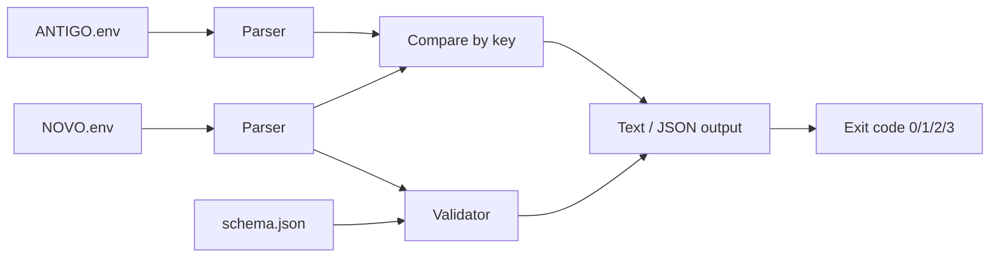

# dotenv Manager

Compare two `.env` files, list typed changes, optionally validate the new state
against a JSON schema, and flag breaking changes — with values masked by default.

```
./app diff ANTIGO.env NOVO.env [--show-values] [--schema schema.json] [--json]
```


> The GIF is optional in v0.1. If it is not present, `demo.tape` still records
> the same demo with [vhs](https://github.com/charmbracelet/vhs):
> `vhs demo.tape`.

## Install

Requires Python 3.8+ and nothing else (standard library only).

```bash
git clone https://github.com/forgeline-labs/dotenv-manager.git
cd dotenv-manager
./setup
./app --version
```

`./setup` is idempotent and only checks the interpreter; there are no
third-party runtime dependencies.

## Usage

```
./app diff ANTIGO.env NOVO.env [--show-values] [--schema schema.json] [--json]
./app --version
./app --help
```

| Option | Description |
|---|---|
| `--show-values` | Show real values (default: `[redacted]`) |
| `--schema schema.json` | Validate values from `NOVO.env` against a JSON schema |
| `--json` | Emit only JSON on stdout |

| Exit code | Meaning |
|---|---|
| `0` | Files are equivalent; no changes |
| `1` | Changes exist, none of them breaking (or schema validation failed) |
| `3` | At least one breaking change exists |
| `2` | Error (I/O, parse, arguments, schema) |

Precedence: `2` > `3` > `1` > `0`. On error, `stdout` is empty and `stderr`
contains `error: <message>`. Warnings are written to `stderr`.

## Examples

### 1. Identical files

`ANTIGO.env` and `NOVO.env` both contain:

```
PORT=8080
DEBUG=false
```

```console
$ ./app diff ANTIGO.env NOVO.env
no differences
$ echo $?
0
```

### 2. Masked diff, then `--show-values`

`ANTIGO.env`:

```
PORT=8080
```

`NOVO.env`:

```
PORT=9090
```

```console
$ ./app diff ANTIGO.env NOVO.env
~ key.changed PORT : [redacted] -> [redacted]

$ ./app diff ANTIGO.env NOVO.env --show-values
~ key.changed PORT : 8080 -> 9090

$ ./app diff ANTIGO.env NOVO.env --json
{
  "version": "0.1.0",
  "breaking": false,
  "summary": { "added": 0, "removed": 0, "changed": 1 },
  "changes": [
    {
      "kind": "key.changed",
      "key": "PORT",
      "breaking": false,
      "before": "[redacted]",
      "after": "[redacted]"
    }
  ],
  "validation_errors": [],
  "warnings": []
}
```

### 3. Breaking change plus schema validation

`schema.json`:

```json
{
  "PORT": { "type": "number" },
  "DEBUG": { "type": "boolean" }
}
```

`ANTIGO.env`:

```
PORT=8080
DEBUG=false
SECRET_TOKEN=xyz123
```

`NOVO.env`:

```
PORT=9090
DEBUG=true
```

```console
$ ./app diff ANTIGO.env NOVO.env --schema schema.json --show-values
~ key.changed DEBUG : false -> true
~ key.changed PORT : 8080 -> 9090
- key.removed SECRET_TOKEN : xyz123 -> [removed]
breaking: 1 change(s)
$ echo $?
3
```

## Supported .env format (v0.1)

Accepted exactly:

- `KEY=value`, where `KEY` matches `[A-Za-z_][A-Za-z0-9_]*` (case-sensitive).
- Leading whitespace before the key is ignored; whitespace after `=` is
  preserved as part of the value.
- The first `=` splits key and value; additional `=` characters are part of the
  value (`KEY=a=b` → value `a=b`).
- Blank lines and whitespace-only lines are ignored.
- Comments are lines whose first non-whitespace character is `#`.
- `#` inside a value is a literal character, not a comment.
- Empty values (`KEY=`) are valid and distinct from a removed key.
- Values are UTF-8; quotes and backslashes are literal characters.
- CRLF line endings are accepted.
- Input files are limited to 10 MiB, 1,000,000 characters per line, and 10,000
  keys; exceeding a limit is an error (exit `2`).

Not supported — any of these is a controlled parse error (exit `2`):

- `export KEY=value`.
- Variable interpolation (`${VAR}`, `$VAR`).
- Duplicate keys in the same file.
- Values spanning multiple lines (a newline ends the line).
- Invalid UTF-8.
- Lines that are not blank, comments, or `KEY=value`.

Non-objectives: Vault/1Password/external secret managers, `.env.local` /
`.env.production` discovery, writes or migrations, history/versioning, pretty
printing beyond text/JSON, encryption, proprietary dialects, reverse diff,
multi-file merge, and remote sync.

## Value masking and security

Values are masked as `[redacted]` in **both** text and JSON output by default,
including in diff entries. Only `--show-values` reveals real values. Validation
warnings never echo raw values, so a masked run cannot leak secrets through
`stderr`. The tool is read-only and performs no network requests.

## How this was built

The specification was written first. The implementation was produced by an
autonomous AI agent working from that specification, without human edits to the
code. The black-box acceptance tests were written by a **different, independent
AI agent** from the same specification and are run out-of-repository by a judge;
they were not written by a person.

## Tests

The public suite is black-box and uses only the standard library:

```bash
python3 -m unittest discover -s tests -v
```

Every test invokes `./app` as a subprocess and asserts on exit code, `stdout`,
`stderr`, and the `--json` payload. No test imports implementation modules.

## Lint

```bash
python3 -m pip install flake8
flake8 src tests
```

## Architecture



## License

MIT — see [LICENSE](LICENSE).
